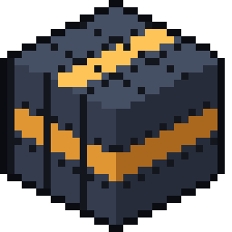

<p align="center"></p>

<h1 align="center">Weft</h1>

<p align="center">
  
  
  
  <a href="LICENSE"></a>
</p>

<p align="center">
  <a href="https://github.com/VortexSo4/Weft/releases"><b>Download</b></a> ·
  <a href="docs/modding.md"><b>Modding</b></a> ·
  <a href="docs"><b>Documentation</b></a> ·
  <a href="#project-status"><b>Project status</b></a> ·
  <a href="#contributing"><b>Contributing</b></a>
</p>

Weft is a voxel sandbox engine written in Rust. The game itself is a mod, `mods/base`, built only on the public SDK: it has no private hooks into the engine, so anything it does, another mod can do or change. Weft is not a Minecraft clone and does not read Minecraft worlds; it plays like one and borrows its numbers where that makes sense.

> Not an official Minecraft product. Not approved by or associated with Mojang or Microsoft. Weft contains no Minecraft code or assets.

## What works today

- **World:** cubic 16³ chunks with no height or depth limit, terrain generated on the GPU, distant terrain drawn past the view distance, caves, biomes with blended colors, several dimensions.
- **Simulation:** the world is split into regions ticked in parallel; plants, furnaces and other timed blocks catch up on time nobody was there for, instead of random ticks.
- **Rendering:** RGB block light, connected and random texture variants, animated and glowing textures, Blockbench models with keyframe animations, resource packs and shader packs.
- **Gameplay:** survival and creative, crafting and smelting, mobs with pathfinding, liquids and buckets for any liquid, machines with energy, moving structures you can stand and build on.
- **Multiplayer:** peer to peer. Open to Friends in the pause menu gives a ticket, a friend joins with it; no server or port forwarding.
- **Mods:** native libraries behind a C ABI, packed as zip files and loaded in parallel. Content is registered with builders, behavior hooks in through events, interceptors and value chains, and recipes, loot and worldgen are driven by tags. See [Modding](#modding).
- **Tools:** textures, translations, shaders and UI reload in game, debug overlays, a recipe viewer, crash reports that name the mod that was running.

## Download

Get the latest build from [Releases](https://github.com/VortexSo4/Weft/releases), unpack it and run `weft`. You need a GPU with Vulkan. Only Windows is tested so far.

Weft ships with its own textures. If Minecraft is installed through the official launcher or Prism, Weft builds a resource pack from that copy when it starts. The pack stays on your computer and can be turned off in Settings > Resource Packs.

## Build from source

Requires Rust 1.90 or newer.

```sh
git clone https://github.com/VortexSo4/Weft.git
cd Weft
cargo run --release
```

Run it from the repository root. Release builds pack each mod in `mods/` into `run/mods/` on start; settings, saves and logs go to `run/`. `cargo run --release -- --dist <dir>` makes a standalone build to share.

## Modding

Copy [`examples/examplemod`](examples/examplemod): every kind of registration is there as a commented example. Then read the [modding cheat sheet](docs/modding.md); the guides for worldgen, machines, models, UI, tooltips, textures, CTM, resource packs and shaders are in [`docs/`](docs). [`mods/base`](mods/base) is the game itself and [`mods/testmod`](mods/testmod) shows a mod extending and replacing it without engine changes.

## Project status

Early. The mod interface and the save format can still change between versions. A mod built against another engine version refuses to load and asks to be rebuilt rather than crashing.

## Contributing

Issues and pull requests are welcome, for the engine, mods, textures or docs.

## License

[MPL-2.0](LICENSE). Minecraft is a trademark of Mojang Synergies AB.

Made by [VortexSo4](https://github.com/VortexSo4).
